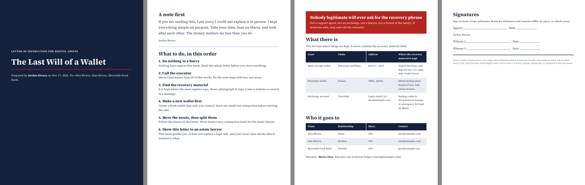

# Last Will of a Wallet

A crypto inheritance kit built with **[`@hyper-elements/react`](https://github.com/hyper-elements/hyper-elements)**. One validated data object renders **four outputs**:

| Output | Root | Rendered with | File |
|---|---|---|---|
| Letter of instruction (4 pages, Letter) | `Document` | `renderPdf()` | `out/letter-of-instruction.pdf` |
| Heir walkthrough page | `Page` | `render()` | `out/index.html` |
| Check-in email (the dead man's switch prompt) | `Email` | `render()` | `out/email-checkin.html` |
| Heir notice email | `Email` | `render()` | `out/email-heir.html` |




## Why it exists

Most crypto inheritance advice assumes the heir already knows what a wallet is. This kit writes the letter an heir actually needs: what exists, who is in charge, what to do first, and what never to do.

## The safety guard

`validateWill()` in `src/data.ts` refuses to build if any field looks like a secret: a 12 word recovery phrase shape, a 64 character hex private key, or a Bitcoin WIF key. It also checks that heir shares add up to 100%. Both the build and the tests call it. It is a heuristic and cannot prove a file is clean, so the rule stays: describe **where** things are kept, never **what** they are.

```bash
npm test
```

## How Hyper Elements is used

- **One theme.** `defineTheme()` in `src/theme.ts` holds the notary palette (navy, wax-seal red, mist), the serif font, the heading scale and the button style. All four roots take the same `theme`, and designs read colors with `token("colors.seal")`.
- **Shared content, four roots.** `src/template.tsx` writes each section once (cover, note, steps, scam warning, asset register, shares, signatures) and places it in a `Document` (as `Document.Page`s, with a full-bleed navy cover), a `Page` or an `Email`.
- **Different content per output.** The web page leaves out where recovery material is stored. The PDF includes it. The heir email shows only the first three steps. The page uses a slimmer shares table so it reads well on a phone.
- **Real PDF.** `renderPdf()` from `@hyper-elements/react/pdf` writes the letter. No browser is needed.
- **Tables** (`Table`, `TableRow`, `TableCell`) with navy header cells and striped rows. **Also used:** `Section`, `Column`, `Heading`, `Text`, `Span`, `Button`, `Divider`.

## Run it

```bash
npm install     # also copies the font from @fontsource into public/fonts
npm run all     # tests, then writes everything to out/
```

Open `out/index.html` in a browser. Everything runs on **sample data for a fictional person** in `src/data.ts`. Replace it with your own details.

## Limits

- The check-in timer and sending of emails need a small backend (a scheduled job and an email provider). This template renders the content only.
- Email clients cannot load web fonts, so the emails fall back to Georgia.

## Important

This is a letter of instruction, not a legal will or financial advice. It does not transfer ownership by itself. Ask an estate lawyer how your local law treats digital assets. Never write a recovery phrase, private key or password into this project.

Font: Source Serif 4 (SIL Open Font License). MIT licensed.
