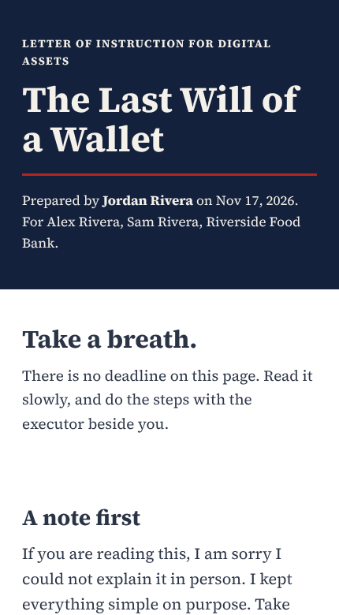
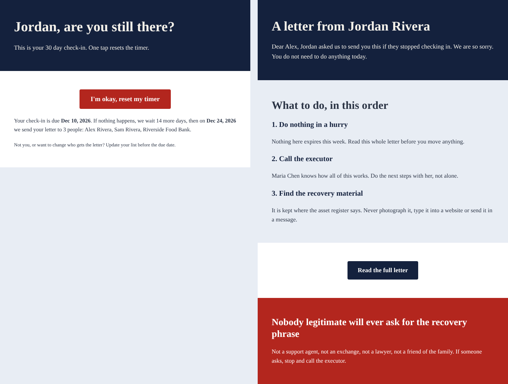

# Last Will of a Wallet

A crypto inheritance kit built with **Hyper Elements** (`@unlayer/react-elements`). One validated data object renders **four outputs**:

| Output | Root | Purpose |
|---|---|---|
| Letter of instruction (PDF) | `Document` | The printable letter: asset register with where recovery material is kept, who gets what, ordered steps, signature block |
| Walkthrough page | `Page` | A calm, slow page for heirs. Storage locations are deliberately left off it |
| Check-in email | `Email` | The dead man's switch prompt: one tap resets the timer |
| Heir notice email | `Email` | The first three steps, a link to the full letter, and a scam warning |






## Why it exists

Most crypto inheritance advice assumes the heir already knows what a wallet is. This kit writes the letter an heir actually needs: what exists, who is in charge, what to do first, and what never to do.

## The safety guard

`validateWill()` in `src/data.ts` refuses to build if any field looks like a secret: a 12 word recovery phrase shape, a 64 character hex private key, or a Bitcoin WIF key. It also checks that heir shares add up to 100%. The build and the tests both call it. It is a heuristic and cannot prove a file is clean, so the rule stays: describe **where** things are kept, never **what** they are.

```bash
npm test
```

## How Hyper Elements is used

- **One component tree, four roots.** `src/template.tsx` builds each section once (`Cover`, `Note`, `Steps`, `Register`, `Shares`, `Signatures`) and assembles them differently under `Email`, `Page` and `Document`.
- **Output specific content.** The web page leaves out storage locations, the PDF includes them, and the heir email shows only the first three steps.
- **Components used:** `Email`, `Page`, `Document`, `Row`, `Column`, `ColumnLayouts`, `Heading`, `Paragraph`, `Button`, `Table` (header colors, fonts and striped rows), `Divider`, `PageBreak`.
- **Custom React components** (`Block`, `H`, `P`, `Rule`) return Elements, so the design system lives in code.
- **`renderToHtml`** writes the four HTML files and **`renderToJson`** writes `out/design.json` for the Unlayer visual editor.
- **PDF:** `Document` mode outputs print HTML, and `src/pdf.ts` prints it with Playwright.

## Run it

```bash
npm install
npm run build                      # writes out/*.html and out/design.json
npx playwright install chromium    # first time only
npm run pdf                        # writes out/letter-of-instruction.pdf
```

Everything runs on **sample data for a fictional person** in `src/data.ts`. Replace it with your own details. The check-in timer and the sending of emails need a small backend (a cron job and an email provider), which this template does not include.

## Important

This is a letter of instruction, not a legal will or financial advice. It does not transfer ownership by itself. Ask an estate lawyer how your local law treats digital assets. Never write a recovery phrase, private key or password into this project.

MIT licensed.
